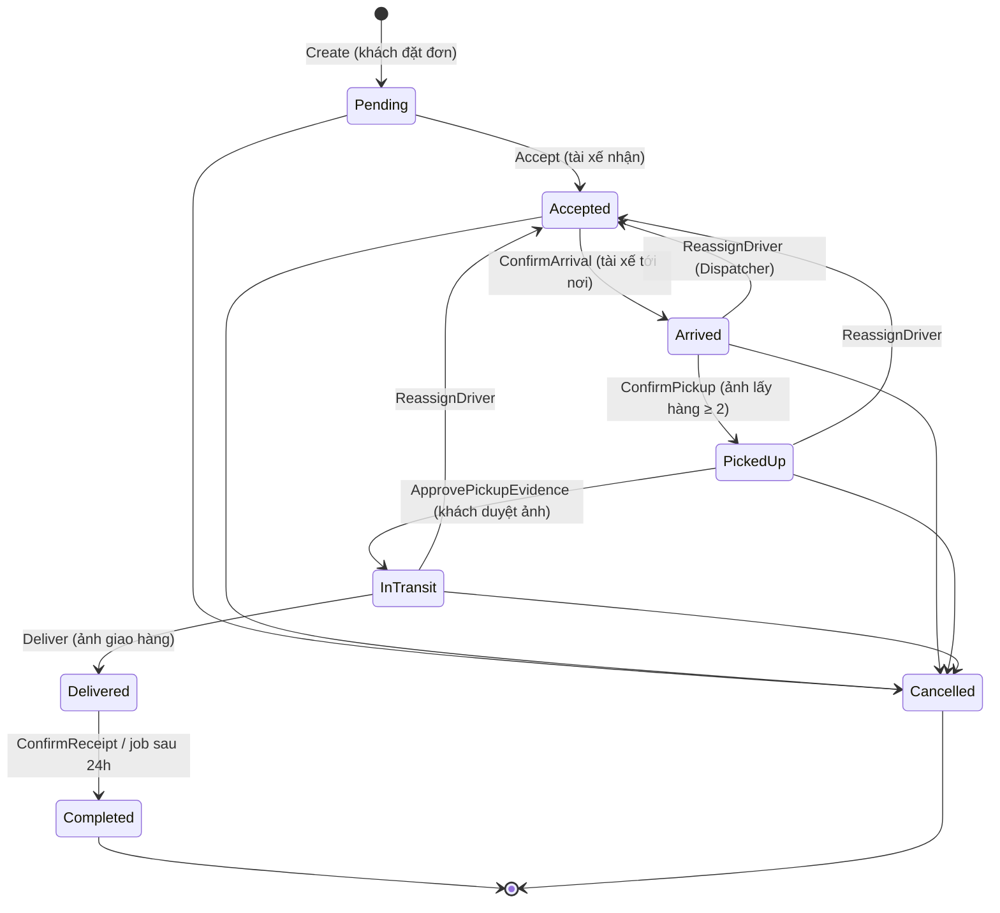

# Phân tích kiến trúc ModMove Backend

Bản phân tích Clean Architecture của backend: từng tầng, từng thư mục, từng nhóm class, cách chúng tương tác và vì sao có chúng. Nguồn sự thật về quy tắc vẫn là [ARCHITECTURE.md](ARCHITECTURE.md) và [DECISIONS.md](DECISIONS.md); file này giải thích và đánh giá.

Dựa trên mã nguồn nhánh `feature/hieu`, commit `617ff46` (09/11/2026, sau khi đổi bản đồ từ Google Maps sang MapVina). Số liệu đếm trực tiếp từ code.

| | |
|---|---|
| Project trong `src/` | 4 |
| Entity / enum | 22 / 23 |
| Use case | 101 (62 command, 39 query) |
| Controller / endpoint | 36 / khoảng 101 |
| Test method (`[Fact]`/`[Theory]`) | 987: unit 325, integration 658, kiến trúc 4 |

Công nghệ: .NET 8, MediatR 12.4 (giữ 12.x vì bản 13 cần license), FluentValidation 11, EF Core 8 + Pomelo MySQL cho ghi, Dapper cho đọc, SignalR, JWT, BCrypt, xUnit.

## Mục lục

1. [Clean Architecture trong ModMove](#1-clean-architecture-trong-modmove)
2. [Một request đi qua các tầng](#2-một-request-đi-qua-các-tầng-khách-đặt-đơn)
3. [Ghi và đọc tách riêng (CQRS)](#3-ghi-và-đọc-tách-riêng-cqrs)
4. [Tầng Domain](#4-tầng-domain)
5. [Tầng Application](#5-tầng-application)
6. [Tầng Infrastructure](#6-tầng-infrastructure)
7. [Tầng WebApi](#7-tầng-webapi)
8. [Bộ test giữ kiến trúc](#8-bộ-test-giữ-kiến-trúc)
9. [Cơ chế xuyên tầng](#9-cơ-chế-xuyên-tầng)
10. [Thêm một use case mới](#10-thêm-một-use-case-mới)
11. [Điểm mạnh và chỗ cần lưu ý](#11-điểm-mạnh-và-chỗ-cần-lưu-ý)

---

## 1. Clean Architecture trong ModMove

Clean Architecture (Robert C. Martin, còn gọi là Onion Architecture) xếp code thành các vòng đồng tâm. Vòng trong chứa thứ quan trọng và ít đổi nhất là luật nghiệp vụ. Vòng ngoài chứa chi tiết kỹ thuật dễ thay: database, framework web, SDK của bên thứ ba.

**Quy tắc phụ thuộc**: code ở vòng trong không biết vòng ngoài tồn tại. Khi vòng trong cần một việc của vòng ngoài (lưu vào MySQL, gửi email, gọi PayOS), nó chỉ khai báo một interface, gọi là **port**. Vòng ngoài viết class hiện thực interface đó, gọi là **adapter**, rồi đăng ký vào DI container. Đây là nguyên lý Dependency Inversion (chữ D trong SOLID): cả hai bên cùng phụ thuộc vào interface, và interface nằm ở bên trong.

```
            ┌──────────────────────────────────────────────┐
            │  WebApi              │       Infrastructure  │
            │  Controllers, Hub,   │  EF Core, Dapper,     │
            │  Middleware,         │  PayOS, MapVina, FCM, │
            │  Program.cs          │  Cloudinary, SMTP,    │
            │        │             │  Background jobs      │
            │        ▼             │            │          │
            │   ┌──────────────────┴────────────▼───┐      │
            │   │  Application                      │      │
            │   │  Command, Query, Handler,         │      │
            │   │  Validator, Behaviors, Interface  │      │
            │   │        ┌───────────────┐          │      │
            │   │        │  Domain       │          │      │
            │   │        │  Entity, Enum,│          │      │
            │   │        │  BusinessRules│          │      │
            │   │        └───────────────┘          │      │
            │   └───────────────────────────────────┘      │
            └──────────────────────────────────────────────┘
   Mũi tên: hướng phụ thuộc. WebApi còn tham chiếu Infrastructure,
   nhưng chỉ để gọi AddInfrastructure() trong Program.cs.
```

### Vì sao dự án này chọn Clean Architecture

| Nhu cầu của ModMove | Kiến trúc giải quyết thế nào |
|---|---|
| Luật tiền phức tạp: giá cước B1, hoa hồng M1, ví cọc tài xế GB-15/16, hoàn tiền B9 | Luật nằm trong entity ở Domain, là C# thuần nên test bằng unit test chạy trong mili giây, không cần MySQL. |
| Ba người làm song song theo module (TEAM-PLAN mục 2) | Mỗi use case là một thư mục riêng. MediatR và FluentValidation tự quét assembly, nên thêm tính năng không phải sửa file đăng ký DI chung, ít xung đột merge. |
| Không phải máy nào cũng có key PayOS, MapVina, Cloudinary, Firebase | Handler chỉ biết interface. Thiếu key thì Infrastructure đăng ký bản thay thế (`NotConfigured…`, `LogOnly…`), app vẫn chạy các luồng khác. |
| Hai client riêng: web React và app Flutter (DECISIONS C11) | Backend chỉ lộ HTTP và WebSocket. Lỗi luôn ra một dạng ProblemDetails với trường `code` ổn định để client rẽ nhánh. |
| Test handler không dùng DB thật (DECISIONS C2) | Vì handler phụ thuộc interface, test thay repository bằng bản in-memory trong `Fakes.cs` mà vẫn chạy pipeline MediatR thật. |

### Bốn project và luật tham chiếu

| Project | Tham chiếu project | Package chính | Bị cấm (test kiến trúc kiểm) |
|---|---|---|---|
| `ModMove.Domain` | không có | không có, chỉ .NET | Application, Infrastructure, WebApi, MediatR, EF Core, ASP.NET Core |
| `ModMove.Application` | Domain | MediatR 12.4.1, FluentValidation 11.11, Dapper 2.1.35, Logging.Abstractions | Infrastructure, WebApi, EF Core, ASP.NET Core |
| `ModMove.Infrastructure` | Domain, Application | Pomelo.EntityFrameworkCore.MySql 8.0.2, BCrypt.Net-Next, CloudinaryDotNet, System.IdentityModel.Tokens.Jwt, Extensions.Http | WebApi, ASP.NET Core |
| `ModMove.WebApi` | Application, Infrastructure | JwtBearer, Swashbuckle, EF Core Design (cho lệnh `dotnet ef`) | không cấm: đây là composition root |

WebApi tham chiếu Domain gián tiếp qua Application. Application được dùng Dapper và `IDbConnection`: đây là lựa chọn có chủ ý cho phía đọc, giải thích ở mục 3.

---

## 2. Một request đi qua các tầng: khách đặt đơn

Theo dõi `POST api/customer/orders` từ lúc vào server tới lúc trả `201`.

| # | Tầng | Class | Việc | Có thể dừng với lỗi |
|---|---|---|---|---|
| 1 | WebApi | `ExceptionHandlingMiddleware` | Bọc toàn bộ request trong try/catch; mọi exception phía sau được đổi thành ProblemDetails ở đây. | |
| 2 | WebApi | JwtBearer + `RoleConvention` | Kiểm tra token. Controller nằm trong `Controllers/Customer` nên đã được gắn policy chỉ cho role Customer. | 401 / 403 |
| 3 | WebApi | `OrdersController.Create` | MVC đọc JSON thành `CreateOrderCommand`, controller chỉ gọi `Sender.Send(command)`. | |
| 4 | Application | `LoggingBehavior` | Ghi log tên request, đo thời gian; quá 500 ms thì log Warning. | |
| 5 | Application | `ValidationBehavior` → `CreateOrderCommandValidator` | Kiểm tra độ dài, số điện thoại, số ảnh 1..5, ảnh phải là URL Cloudinary của nhóm (gọi `IFileStorage.IsOwnedUrl` → `CloudinaryFileStorage`). | 400 `VALIDATION` |
| 6 | Application | `CreateOrderCommandHandler` | `currentUser.LoadUserAsync(users)` lấy khách đang đăng nhập, chặn tài khoản không Active (`ICurrentUserService` → `CurrentUserService` ở WebApi; `IUserRepository` → `UserRepository`). | 403 `ACCOUNT_INACTIVE` |
| 7 | Application | `OrderPricing.PriceAsync` | Lấy loại xe, kiểm tra hàng có vừa xe, tìm coupon, geocode hai địa chỉ, lấy quãng đường, đọc phí bốc xếp (`IRepository<VehicleType>`, `ICouponRepository`, `IMapService` → `MapVinaMapService`, `IPlatformSettings` → `PlatformSettings`). | 404 · 422 `VEHICLE_TOO_SMALL`, `ADDRESS_NOT_FOUND`, `ROUTE_NOT_FOUND` |
| 8 | Domain | `FareCalculator.Calculate` → `FareQuote` | Tính cước theo B1, trừ coupon, làm tròn đến đồng. `EnsureMatches` so với tổng khách đã thấy. | 422 `FARE_CHANGED` |
| 9 | Domain | `ShippingOrder.Create`, `Coupon.MarkUsed` | Tạo đơn trạng thái Pending, kiểm tra đơn tiền mặt phải có người trả, ghi dòng lịch sử đầu tiên. | 422 `BUSINESS_RULE` |
| 10 | Infrastructure | `ApplicationDbContext.SaveChangesAsync` | Handler gọi `orders.Add` rồi `unitOfWork.SaveChangesAsync`. Interceptor gán `CreatedAt`; EF ghi đơn, hàng hóa, lịch sử trong một transaction. | 409 `CONFLICT` nếu trùng `order_code` |
| 11 | WebApi | `OrdersController.Create` | Trả `201` với `CreateOrderResponse(Id, OrderCode, TotalFee)`. | |

Handler ở bước 6 đến 10 không biết MySQL, MapVina hay HTTP là gì. Nó chỉ thấy interface do chính Application khai báo, nên trong test cùng handler này chạy với `InMemoryOrders` và bản đồ giả.

---

## 3. Ghi và đọc tách riêng (CQRS)

Mỗi use case là một **Command** (đổi dữ liệu) hoặc một **Query** (chỉ đọc). Hai phía dùng hai cách truy cập dữ liệu khác nhau vì nhu cầu khác nhau.

| | Command (`ICommand` / `ICommand<T>`) | Query (`IQuery<T>`) |
|---|---|---|
| Truy cập dữ liệu | `IRepository<T>` hoặc repo riêng, rồi `IUnitOfWork.SaveChangesAsync`. Phía sau là EF Core. | `ISqlConnectionFactory.CreateConnection()` + Dapper, SQL viết tay với tham số `@Name`. |
| Vì sao | Cần nạp cả aggregate để gọi method luật nghiệp vụ, cần change tracking, transaction và khóa lạc quan `RowVersion` (tài xế nhận đơn trước thắng, GB-08). | Màn hình cần JOIN nhiều bảng, lọc, phân trang, DTO đúng hình dạng. Không cần tracking. SELECT thường trên InnoDB không khóa, nên query không chặn command. |
| Trả về | Kết quả tối thiểu: Id, mã đơn, hoặc không gì (`204`). | DTO cho màn hình; danh sách là `PagedResult<T>`. |
| Mẫu để copy | `Features/Auth/Commands/Login` | `Features/Catalog/Queries/GetVehicleTypes` |

**Luật được ép bằng test**: `LayerDependencyTests.Query_handlers_do_not_use_write_side_persistence` quét constructor của mọi class hiện thực `IQueryHandler<,>`; class nào nhận `IRepository` hay `IUnitOfWork` làm test fail. Các interface `ICommand`/`IQuery` chỉ là lớp mỏng bọc `IRequest` của MediatR, tồn tại để test nhận ra phía nào là phía nào.

**Cái giá phải trả**: SQL trong Application biết tên bảng, tên cột snake_case (`shipping_orders.order_status`). Đổi schema phải sửa cả Configuration, migration và các câu SQL liên quan.

---

## 4. Tầng Domain

`src/ModMove.Domain`, vòng trong cùng.

**Nhiệm vụ**: chứa luật nghiệp vụ và trạng thái hợp lệ của dữ liệu. Không tham chiếu project hay package nào; mọi class là C# thuần nên tạo bằng `new`/factory và test trực tiếp.

- **Ai dùng**: Application (handler gọi method entity), Infrastructure (EF Core map entity xuống bảng).
- **Quy ước**: constructor `private` + factory `static Create(...)`; property `private set`; collection con lộ ra dạng `IReadOnlyCollection`. Không ai đổi trạng thái mà bỏ qua được luật.
- **Vi phạm luật**: `throw new DomainException("message", "STABLE_CODE")` → HTTP 422.

### `Domain/AssemblyReference.cs`

Class static giữ `Assembly` của project. `LayerDependencyTests` dùng nó để đọc danh sách assembly mà Domain tham chiếu.

### `Domain/Common/` (4 file, lớp nền cho mọi entity)

| Class | Nhiệm vụ và cách hoạt động |
|---|---|
| `BaseEntity` | `Id` kiểu `long` (BIGINT do DB sinh), `protected set`. So sánh bằng theo kiểu + Id; entity chưa lưu (Id = 0) chỉ bằng chính nó, tránh hai đơn mới bị coi là một. |
| `BaseCreatedEntity` | Thêm `CreatedAt`. Dùng cho bảng chỉ cần mốc tạo, phần lớn chỉ ghi thêm: `OrderStatusHistory`, `Rating`, `OtpVerification`, `RefreshToken`, `DriverLocationLog`. |
| `BaseAuditableEntity` | Thêm `UpdatedAt`. Cả hai mốc thời gian do `AuditableEntityInterceptor` ở Infrastructure tự gán khi lưu; handler không tự gán. |
| `IAggregateRoot` | Interface rỗng đánh dấu gốc aggregate. `IRepository<T>` ràng buộc `where T : IAggregateRoot`, nên entity con (`CargoDetail`, `WalletTransaction`…) không thể có repository riêng, phải sửa qua gốc. |

**Vì sao có aggregate**: một aggregate là nhóm dữ liệu phải luôn nhất quán cùng nhau. Đơn hàng và lịch sử trạng thái của nó đổi trong cùng một lần lưu; nếu cho sửa lịch sử trực tiếp, lịch sử có thể lệch với trạng thái đơn.

### `Domain/Entities/` (22 entity: 16 gốc aggregate, 6 entity con)

| Gốc aggregate | Entity con | Luật nghiệp vụ tiêu biểu (method) |
|---|---|---|
| [`ShippingOrder`](../src/ModMove.Domain/Entities/ShippingOrder.cs) (446 dòng, lớn nhất) | `CargoDetail`, `ProofOfDelivery`, `OrderStatusHistory` | Máy trạng thái `AllowedTransitions` (sơ đồ bên dưới). `CancelByCustomer` chỉ khi Pending/Accepted (`ORDER_NOT_CANCELLABLE`). `ConfirmPickup` cần ≥ 2 ảnh, gửi lại tối đa 5 lần (`PICKUP_PHOTO_LIMIT`). `FileComplaint` trong 24 giờ sau giao. `Complete` chốt hoa hồng = rate × total_fee. `EnsureCustomer` chống IDOR (`ORDER_NOT_YOURS`). `RowVersion` tăng mỗi lần đổi trạng thái quan trọng. |
| `User` | không | Mọi tài khoản (4 role). Đếm đăng nhập sai, khóa 10 phút sau 5 lần (GB-02): `RegisterFailedLogin`, `IsLocked`. Trạng thái Active/Inactive/Locked, FCM token của thiết bị. |
| `DriverProfile` | `DriverApplication`, `Vehicle` | Hồ sơ tài xế đã duyệt, trạng thái Online/Offline. Mỗi lần nộp giấy tờ là một `DriverApplication`; xe có biển số duy nhất (GB-04). |
| [`DriverWallet`](../src/ModMove.Domain/Entities/DriverWallet.cs) | `WalletTransaction` | Ví cọc + ví thu nhập. `CanReceiveCod` (GB-16), `TopUpDeposit` ≥ 50.000đ, `DeductCommissionFromDeposit` cho phép âm, `RequestWithdrawal` trừ nợ hoa hồng trước. Mọi biến động sinh một `WalletTransaction` và tăng `RowVersion`. |
| `PaymentTransaction` | không | Một phiên thanh toán PayOS: mã PayOS, số tiền, hạn, trạng thái Pending/Paid/Failed/Cancelled/Expired. |
| `Refund` | không | Hoàn tiền từ hủy đơn, sự cố hoặc khiếu nại. Requested → Approved/Rejected → Processed/Failed, hoặc Withdrawn. Dispatcher đề xuất, Admin duyệt. |
| `InTransitIncident` | không | Sự cố trong chuyến (GB-17); Dispatcher quyết định ContinueTrip / ReassignDriver / CancelOrder. |
| `Rating` | không | Một đánh giá mỗi đơn, trong 1 ngày sau hoàn tất, không sửa (GB-20). |
| `Coupon` | không | `EnsureApplicable` (hạn, giá trị tối thiểu), `DiscountFor`, `MarkUsed` (GB-21). |
| `VehicleType` | không | Giá cước `BaseFare`, `PricePerKm`, `MinimumFare`; `CanCarry` kiểm tra tải trọng và kích thước thùng (GB-10). |
| `OtpVerification` | không | OTP 6 số, sống 5 phút, tối đa 3 lần gửi trong 15 phút, 5 lần nhập sai thì hỏng (GB-25). |
| `RefreshToken` | không | Chỉ lưu hash SHA-256 của token, sống 30 ngày, dùng một lần; phân biệt bị thu hồi với bị dùng lại. |
| `PlatformSetting` | không | Cặp khóa/giá trị Admin sửa được: `COMMISSION_RATE`, `LOADING_FEE`, `MIN_COD_DEPOSIT`, `MATCHING_RADIUS_KM`. |
| `MasterDataItem` | không | Danh mục: loại hàng, lý do hủy, lý do khiếu nại, loại sự cố. |
| `SupportRequest` | không | Yêu cầu hỗ trợ từ trang công khai (New/Handled). |
| `DriverLocationLog` | không | Điểm GPS tài xế gửi khi Online, xóa sau 30 ngày. |

### Máy trạng thái của `ShippingOrder`

Đúng bảng `AllowedTransitions` trong `ShippingOrder.cs`. Chuyển sai (ví dụ Delivered → Cancelled) ném `DomainException`.



- Khách tự hủy chỉ khi Pending/Accepted (`CancelByCustomer`). Từ Arrived trở đi, Dispatcher (sự cố) hoặc job hệ thống gọi `Cancel()`.
- `ReassignDriver` đưa đơn về Accepted (từ Accepted, Arrived, PickedUp hoặc InTransit) và đặt lại số lần gửi ảnh.
- Khi khách từ chối ảnh lấy hàng, đơn đứng ở PickedUp và tài xế gửi lại ảnh, tối đa 5 lần.

### `Domain/Enums/` (23 enum)

- Đơn và thanh toán: `OrderStatus`, `PaymentMethod` (PayOS/Cash), `PaymentStatus`, `PaymentTransactionStatus`, `PayerRole`, `ProofStatus`.
- Tài khoản: `UserRole`, `AccountStatus`, `OtpPurpose`, `ApprovalStatus`, `OnlineStatus`, `VehicleStatus`.
- Ví: `WalletStatus`, `WalletTransactionType`, `WalletTransactionStatus`.
- Sự cố và hoàn tiền: `IncidentType`, `IncidentDecision`, `IncidentResolutionStatus`, `RefundSourceType`, `RefundStatus`, `ComplaintStage`.
- Khác: `ChangedByRole`, `SupportRequestStatus`.

**Cách lưu**: `ApplicationDbContext` lưu mọi enum thành VARCHAR mang tên enum (`"Pending"`); API cũng gửi/nhận chuỗi nhờ `JsonStringEnumConverter`. Hệ quả: trong truy vấn không so sánh `>=` theo thứ tự enum vì DB so chuỗi; `ShippingOrderRepository` dùng danh sách trạng thái thay vì khoảng.

### `Domain/Constants/BusinessRules.cs`

Một chỗ duy nhất cho các con số cố định của SRS, để code và test dùng cùng giá trị: `MaxFailedLogins = 5`, `LoginLockDuration` 10 phút, `OtpLifetime` 5 phút, `MaxCargoPhotos = 5`, `MinPickupPhotos = 2`, `MaxPickupSubmissions = 5`, `PayOsSessionLifetime` 10 phút, `PayOsPaymentDeadline` 30 phút, `MatchingTimeout` 10 phút, `AutoCompleteAfterDelivery` và `ComplaintWindow` 24 giờ, `GpsLogRetention` 30 ngày.

**Ranh giới (DECISIONS C8)**: giá trị Admin đổi được nằm ở bảng `platform_settings` và đọc qua `IPlatformSettings`; giá trị cố định nằm ở đây. Không để một giá trị ở cả hai chỗ.

### `Domain/Services/FareCalculator.cs`

**Domain service** dạng hàm thuần. Công thức B1: phí quãng đường = max(MinimumFare, BaseFare + PricePerKm × km), cộng phí bốc xếp nếu chọn, trừ coupon, làm tròn đến đồng. Kết quả là record `FareQuote(DistanceFee, ServiceFee, DiscountAmount, TotalFee)`; `FareQuote.EnsureMatches(expectedTotalFee)` từ chối đặt đơn nếu giá đã đổi so với lúc khách xem.

**Vì sao là domain service mà không là method entity**: phép tính cần dữ liệu của hai aggregate (`VehicleType` và `Coupon`) nên không thuộc riêng entity nào. Ước tính giá và đặt đơn cùng gọi nó qua `OrderPricing`, nên khách trả đúng giá đã xem (DECISIONS 4.4).

### `Domain/Exceptions/DomainException.cs`

Exception duy nhất của Domain. Có `Code` tùy chọn (`ORDER_NOT_CANCELLABLE`, `FARE_CHANGED`…); không có code thì client nhận `BUSINESS_RULE`. Middleware đổi thành HTTP 422. Mã mới phải thêm vào bảng mã lỗi ở [api/README.md](api/README.md).

---

## 5. Tầng Application

`src/ModMove.Application`, vòng thứ hai.

**Nhiệm vụ**: trả lời câu hỏi "hệ thống làm được những việc gì". Mỗi use case điều phối: lấy dữ liệu qua interface, gọi method luật của entity, lưu lại, gửi thông báo. Application cũng là nơi **khai báo** mọi interface ra bên ngoài.

- **Được biết**: Domain, MediatR, FluentValidation, Dapper.
- **Không được biết**: EF Core, ASP.NET Core, Infrastructure, WebApi.
- **Quy ước**: Command/Query/Response DTO là `public sealed record`; Handler và Validator là `internal sealed class`. `InternalsVisibleTo` mở cho UnitTests và IntegrationTests.

### `Application/DependencyInjection.cs`, `AssemblyReference.cs`

`AddApplication()` đăng ký MediatR quét toàn bộ assembly, gắn pipeline theo thứ tự `LoggingBehavior → ValidationBehavior → Handler`, quét validator kể cả class `internal`, và đăng ký ba service dùng chung: `OrderPricing`, `OrderSettlement`, `INotificationService → NotificationService`.

**Vì sao quan trọng**: nhờ quét assembly, thêm một thư mục use case mới là đủ, không sửa file này (nguyên lý Open/Closed). WebApi và test cùng gọi `AddApplication()` nên chạy cùng một pipeline.

### `Application/Common/Messaging/`

| Interface | Vai trò |
|---|---|
| `ICommand`, `ICommand<TResponse>` | Đánh dấu request ghi. Kế thừa `IRequest` / `IRequest<T>` của MediatR. |
| `ICommandHandler<TCommand>`, `ICommandHandler<TCommand, TResponse>` | Handler của command, kế thừa `IRequestHandler`. |
| `IQuery<TResponse>`, `IQueryHandler<,>` | Đánh dấu request đọc và handler của nó; test kiến trúc dựa vào đây để cấm repository. |

### `Application/Common/Behaviors/` (pipeline của MediatR)

| Class | Cách hoạt động |
|---|---|
| `LoggingBehavior<,>` | Bọc ngoài cùng. Log "Handling X", đo bằng Stopwatch, quá 500 ms log Warning "Slow request". |
| `ValidationBehavior<,>` | Nhận mọi `IValidator<TRequest>` từ DI, chạy song song, gom lỗi theo tên field rồi ném `ValidationException` của project. Handler vì vậy được coi input là hợp lệ. |

**Vì sao dùng behavior**: log và validate là việc của mọi use case. Đặt một lần trong pipeline thì 101 handler không phải lặp lại, và không handler nào quên.

### `Application/Common/Exceptions/`

| Exception | HTTP | `code` | Khi nào ném |
|---|---|---|---|
| `ValidationException` | 400 | `VALIDATION` | Do `ValidationBehavior`; có `Errors` theo từng field. Không phải class cùng tên của FluentValidation. |
| `UnauthorizedException` | 401 | `UNAUTHORIZED` | Sai thông tin đăng nhập, token không có user id. |
| `ForbiddenAccessException` | 403 | `FORBIDDEN` hoặc mã riêng | Tài khoản không Active (`ACCOUNT_INACTIVE`), chưa xác minh email (`EMAIL_NOT_VERIFIED`). |
| `NotFoundException` | 404 | `NOT_FOUND` | Không có bản ghi, hoặc bản ghi của người khác trong query (trả 404 để không lộ là có tồn tại). |
| `ConflictException` | 409 | `CONFLICT` | Thua tranh chấp (`RowVersion` cũ) hoặc trùng unique index; do `ApplicationDbContext` dịch từ lỗi EF/MySQL. |

### `Application/Common/Interfaces/` (port: Application khai báo, tầng ngoài hiện thực)

| Interface | Adapter thật (bản thay thế) | Dùng cho |
|---|---|---|
| `ICurrentUserService` | WebApi `CurrentUserService` | Id và role người gọi, đọc từ claim JWT. Application không chạm `HttpContext`. |
| `IPasswordHasher` | Infrastructure `BCryptPasswordHasher` | Hash và kiểm tra mật khẩu (BCrypt cost 12). |
| `IJwtTokenService` | Infrastructure `JwtTokenService` | Tạo access token 15 phút. |
| `IPlatformSettings` + `SettingKeys` | Infrastructure `PlatformSettings` | Đọc 4 khóa cấu hình Admin sửa được. |
| `IExcelExporter` | Infrastructure `OpenXmlExcelExporter` | Xuất báo cáo doanh thu ra Excel. |
| `INotificationService` | Application `NotificationService` | Gửi một thông báo qua cả SignalR và FCM. Hiện thực ngay trong Application vì nó chỉ ghép các port khác. |

[`Ports.cs`](../src/ModMove.Application/Common/Interfaces/Ports.cs) chứa các dịch vụ bên ngoài, kèm record `GeoPoint`, `RouteInfo`, `PaymentLink`, enum `PaymentPlatform`, hằng `RealtimeEvents`:

| Interface | Adapter thật (bản thay thế) | Dùng cho |
|---|---|---|
| `IFileStorage` | `CloudinaryFileStorage` (`NotConfiguredFileStorage`) | Upload ảnh JPG/PNG ≤ 5 MB; `IsOwnedUrl` cho validator kiểm URL ảnh. |
| `IEmailSender` | `SmtpEmailSender` (`LogOnlyEmailSender` ở Development) | Gửi OTP và email thông báo. |
| `IPushNotificationService` | `FcmPushNotificationService` (`LogOnlyPushNotificationService`) | Push FCM tới app di động. Handler không gọi trực tiếp, chỉ qua `INotificationService`. |
| `IPaymentGateway` | `PayOsPaymentGateway` (`NotConfiguredPaymentGateway`) | Tạo link/QR, hủy link cũ, kiểm chữ ký webhook HMAC-SHA256. |
| `IMapService` | `MapVinaMapService` (`NotConfiguredMapService`) | Geocode địa chỉ (MapVina Search v2), quãng đường và thời gian lái xe (Directions v2); dùng để tính cước và ETA khi theo dõi đơn. Không tìm thấy địa chỉ hay đường đi thì adapter ném `DomainException` (`ADDRESS_NOT_FOUND`, `ROUTE_NOT_FOUND`, 422); lỗi key hoặc hết quota là lỗi 500. |
| `IRealtimeNotifier` | WebApi `SignalRRealtimeNotifier` | Đẩy sự kiện tới nhóm `order-{id}`, tới một user, hoặc nhóm `dispatchers`. |

### `Application/Common/Interfaces/Persistence/` (17 interface truy cập dữ liệu)

| Interface | Vai trò |
|---|---|
| `IRepository<TAggregate>` | `GetByIdAsync`, `Add`, `Update`, `Remove`. Không có Save: thay đổi chỉ xuống DB khi handler gọi Unit of Work. |
| `IUnitOfWork` | `SaveChangesAsync`. Một lần gọi là một transaction gồm mọi thay đổi của request. |
| `ISqlConnectionFactory` | `CreateConnection()` trả `IDbConnection` cho Dapper ở phía query. |

Thêm **14 repository riêng**, mỗi cái kế thừa `IRepository<T>` và thêm truy vấn mà command cần: `IUserRepository` (`GetByEmailAsync`, `IsEmailOrPhoneTakenAsync`, `ReleaseFcmTokenAsync`), `IShippingOrderRepository` (`GetWithProofAsync`, `GetPendingAsync`, `CountCreatedBetweenAsync`…), `ICouponRepository`, `IOtpRepository`, `IRefreshTokenRepository` (`RevokeAllForUserAsync`), `IPlatformSettingRepository`, `IDriverProfileRepository`, `IDriverWalletRepository`, `IRefundRepository`, `IIncidentRepository`, `IRatingRepository`, `IMasterDataRepository`, `IDriverLocationLogRepository`, `IPaymentTransactionRepository`.

**Khi nào tạo repo riêng**: khi command cần `Include` entity con hoặc một truy vấn đặc thù. Repo generic không làm được việc đó, và cũng không nên lộ `IQueryable` ra Application vì như vậy EF Core sẽ rò vào trong.

### `Application/Common/` Models, Notifications và helper

| Class | Nhiệm vụ |
|---|---|
| `Models/PagedResult<T>` | Kết quả phân trang `Items, PageNumber, PageSize, TotalCount` + `TotalPages`, `HasNextPage`, `HasPreviousPage`. |
| `Notifications/NotificationService` | Gọi sau `SaveChangesAsync`. Gửi SignalR `NotificationReceived` rồi FCM (timeout 3 giây). Lỗi chỉ log Warning vì hành động đã lưu xong; không dùng token hủy của người gọi để khách mất mạng vẫn không chặn tài xế nhận tin. |
| `Notifications/CustomerNotifications` | Câu chữ và `type` thống nhất cho các sự kiện của khách (DECISIONS 8.3): tài xế nhận đơn, đã tới, ảnh chờ duyệt, đã giao, hệ thống hủy… |
| `Notifications/DriverNotifications` | Tương tự cho tài xế: đơn mới gần bạn, hồ sơ được duyệt/từ chối, rút tiền được xử lý. |
| `CurrentUserExtensions` | `RequireUserId()` → 401 nếu không có id. `LoadUserAsync(users)` nạp user và chặn tài khoản không Active (token còn sống tối đa 15 phút sau khi bị khóa). `InactiveAccount()` tạo cùng lỗi 403 cho cả command và query. |
| `SqlHelpers` | Dùng trong query Dapper: `ToUtc` (MySQL trả DATETIME không múi giờ), `LikeContains` (escape `%`, `_`, `\` người dùng gõ), `ParseJsonList`. |
| `MasterDataChoice` | `RequireActiveAsync`: mã danh mục khách chọn phải tồn tại và đang bật, sai thì 400. `ReasonText`: mục "OTHER" bắt buộc ghi lý do. |

### `Application/Features/` (18 module, 101 use case)

| Module | Cmd | Query | Use case (C = command, Q = query) |
|---|--:|--:|---|
| Auth | 9 | 0 | C: Login, Refresh, Logout, Register, VerifyEmail, ResendOtp, ForgotPassword, ResetPassword, ChangePassword |
| Users | 6 | 3 | C: UpdateMyProfile, DeleteMyAccount, UpdateFcmToken, SubmitSupportRequest, CreateDispatcher, UpdateUserStatus · Q: GetMyProfile, GetUsers, GetUserDetail |
| Orders | 7 | 3 | C: EstimateFare, CreateOrder, CancelOrder, ReviewPickupEvidence, ConfirmReceipt, UploadImage, AutoCompleteDeliveredOrders · Q: GetMyOrders, GetMyOrderDetail, GetAvailableCoupons |
| Payments | 4 | 0 | C: CreateOrderPayment, ProcessPayOsWebhook, ExpireStalePayments, TopUpDeposit |
| Matching | 2 | 1 | C: AcceptOrder, CancelUnmatchedOrders · Q: GetNearbyOrders |
| Tracking | 2 | 3 | C: UpdateDriverLocation, PurgeOldLocationLogs · Q: GetOrderTracking, CanFollowOrder, IsActiveAccount |
| Incidents | 6 | 4 | C: ReportIncidentByCustomer, StartIncidentHandling, ResolveIncidentContinue, ReassignIncidentDriver, CancelOrderByIncident, CancelIncident · Q: GetMyIncidents, GetIncidentById, ListIncidents, GetReplacementDrivers |
| Refunds | 11 | 6 | C: SubmitComplaint, RequestIncidentRefund, WithdrawRefund, ReplyToInfoRequest, RequestComplaintInfo, RequestIncidentRefundInfo, ProposeComplaintResolution, ProposeIncidentRefundResolution, ApproveRefund, RejectRefund, ProcessRefundPayout · Q: GetMyRefunds, GetMyRefundDetail, ListComplaints, GetComplaintById, GetAdminRefunds, GetAdminRefundDetail |
| Ratings | 1 | 1 | C: RateTrip · Q: GetMyRatings |
| DriverOnboarding | 3 | 3 | C: SubmitDriverApplication, ApproveDriverApplication, RejectDriverApplication · Q: GetMyApplicationStatus, GetPendingApplications, GetApplicationDetails |
| Drivers | 1 | 1 | C: SetOnlineStatus · Q: GetDriverStatus |
| Wallets | 2 | 2 | C: ApproveWithdrawal, RejectWithdrawal · Q: GetAdminWithdrawals, GetAdminWithdrawalDetail |
| Monitoring | 0 | 5 | Q: ListDispatcherOrders, GetDispatcherOrderById, GetDispatcherOrdersSummary, ListOnlineDrivers, ListHandledCases |
| Pricing | 3 | 1 | C: UpdateVehicleTypeFares, SetVehicleTypeStatus, UpdatePlatformSettings · Q: GetPricingConfigurations |
| MasterData | 5 | 3 | C: CreateMasterDataItem, UpdateMasterDataItem, SetMasterDataStatus, Coupons/CreateCoupon, Coupons/SetCouponStatus · Q: GetMasterDataList, GetPublicContent, Coupons/GetCoupons |
| Catalog | 0 | 1 | Q: GetVehicleTypes |
| Reports | 0 | 2 | Q: GetRevenueReport, ExportRevenueReport |
| Trips | 0 | 0 | chỉ có `.gitkeep` (xem mục 11) |

### Class dùng chung trong một module

Khi hai use case cùng module cần cùng một logic điều phối, logic đó đặt ở gốc thư mục module, không đẩy lên `Common`.

| Class | Dùng bởi và nhiệm vụ |
|---|---|
| `Orders/OrderPricing` | EstimateFare và CreateOrder. Chuỗi: loại xe và hàng vừa xe → MapVina km → `FareCalculator` → coupon. Một giá cho cả hai bước. |
| `Orders/OrderSettlement` | ConfirmReceipt và job tự hoàn tất. Đơn PayOS: cộng thu nhập ví = total − hoa hồng. Đơn tiền mặt: trừ hoa hồng từ ví cọc. Cùng transaction với việc hoàn tất đơn. |
| `Orders/OrderCode` | Mã đơn `MMyyyyMMddNNN` theo ngày giờ Việt Nam (UTC+7), NNN đếm đơn trong ngày. |
| `Orders/Queries/CustomerAccess` | Bản phía đọc của `LoadUserAsync`: query của khách cũng chặn tài khoản bị khóa. |
| `Orders/DriverNotifications` | Bước của khách báo cho tài xế đang nhận đơn. |
| `Auth/AuthRules`, `OtpCheck`, `RefreshTokens` | Luật mật khẩu, số điện thoại VN, sinh OTP 6 số bằng nguồn ngẫu nhiên mật mã; kiểm OTP; phát refresh token 32 byte và chỉ lưu hash SHA-256. |
| `Matching/GeoDistance` | Công thức Haversine, bản duy nhất trong code: ghép đơn, nhận đơn, thông báo đơn mới, đổi tài xế và tìm tài xế thay thế đều gọi nó. |
| `Incidents/IncidentHandlingRules`, `IncidentNotifications` | Dispatcher nào được xử lý sự cố, tài xế mất GPS quá 5 phút coi là mất kết nối, khoảng cách tài xế thay thế. |
| `Refunds/CustomerRefundRules`, `DispatcherRefundNotifications`, `Queries/RefundRow` | Validate lý do, số tiền, ảnh minh chứng; báo Dispatcher; dòng đọc Dapper cho hoàn tiền của khách. |
| `Reports/RevenueReportData` | DTO doanh thu và đổi giờ UTC sang ngày Việt Nam cho báo cáo. |

### Giải phẫu một use case: `Features/Auth/Commands/Login/`

`LoginCommand.cs` (public sealed record):

```csharp
public sealed record LoginCommand(string Email, string Password) : ICommand<LoginResponse>;
public sealed record LoginResponse(string AccessToken, string RefreshToken, long UserId, string FullName, UserRole Role);
```

`LoginCommandValidator.cs` (internal sealed, chạy trong `ValidationBehavior`):

```csharp
internal sealed class LoginCommandValidator : AbstractValidator<LoginCommand>
{
    public LoginCommandValidator()
    {
        RuleFor(x => x.Email).NotEmpty().MaximumLength(100);
        RuleFor(x => x.Password).NotEmpty().MaximumLength(100);
    }
}
```

`LoginCommandHandler.cs` (internal sealed, chỉ điều phối; rút gọn):

```csharp
internal sealed class LoginCommandHandler(IUserRepository users, IUnitOfWork unitOfWork,
    IPasswordHasher passwordHasher, IJwtTokenService tokenService,
    IRefreshTokenRepository refreshTokens, TimeProvider clock) : ICommandHandler<LoginCommand, LoginResponse>
{
    var user = await users.GetByEmailAsync(AuthRules.Normalize(request.Email), ct);
    // email lạ vẫn chạy BCrypt với hash giả để thời gian phản hồi không lộ email nào tồn tại
    if (user is null || user.IsLocked(now)) throw new UnauthorizedException(InvalidCredentials);
    if (!passwordOk) { user.RegisterFailedLogin(now); await unitOfWork.SaveChangesAsync(ct); throw ...; }
    user.RegisterSuccessfulLogin();                       // luật nằm trong entity User
    var refreshToken = RefreshTokens.Issue(refreshTokens, user.Id, now);
    await unitOfWork.SaveChangesAsync(ct);                 // một transaction
    return new LoginResponse(tokenService.CreateAccessToken(user.Id, user.Role), refreshToken, ...);
}
```

Handler chỉ thấy 6 interface. Đổi BCrypt sang thuật toán khác, đổi MySQL sang PostgreSQL hay đổi JWT HS256 sang RS256 đều không phải sửa file này.

---

## 6. Tầng Infrastructure

`src/ModMove.Infrastructure`, vòng ngoài phía máy móc.

**Nhiệm vụ**: hiện thực các interface của Application bằng công nghệ cụ thể: EF Core + MySQL, Dapper, BCrypt, JWT, HTTP tới PayOS/MapVina/Firebase, SDK Cloudinary, SMTP, job chạy nền.

- **Được biết**: Application, Domain, EF Core, SDK bên ngoài.
- **Không được biết**: WebApi, ASP.NET Core (vì vậy adapter SignalR phải nằm ở WebApi).

### [`Infrastructure/DependencyInjection.cs`](../src/ModMove.Infrastructure/DependencyInjection.cs)

`AddInfrastructure(configuration)` làm theo thứ tự:

1. Thiếu connection string `DefaultConnection` hoặc `Jwt:SigningKey` quá ngắn thì app dừng ngay khi khởi động, không chạy nửa vời.
2. Đăng ký `JwtOptions`, `JwtTokenService`, `BCryptPasswordHasher`, `TimeProvider.System`.
3. Phía ghi: `ApplicationDbContext` với MySQL 8.0.36 cố định (không cần DB sống lúc khởi động), gắn `AuditableEntityInterceptor`. `IUnitOfWork` trỏ vào chính DbContext. `IRepository<>` generic + 14 repo riêng.
4. 4 job nền qua `AddHostedService`.
5. Phía đọc: `ISqlConnectionFactory`, `IPlatformSettings`, `IExcelExporter` dạng singleton.
6. Adapter bên ngoài theo cấu hình: có key thì dùng adapter thật, thiếu key thì bản thay thế. PayOS điền nửa chừng (có ClientId, thiếu ApiKey) thì dừng app.

### `Infrastructure/Persistence/`

| File / thư mục | Nhiệm vụ và cách hoạt động |
|---|---|
| [`ApplicationDbContext`](../src/ModMove.Infrastructure/Persistence/ApplicationDbContext.cs) | DbContext của EF Core và đồng thời là `IUnitOfWork`. `OnModelCreating` nạp mọi Configuration, đặt collation `utf8mb4_unicode_ci`, đổi tên cột sang snake_case, lưu enum thành chuỗi. `SaveChangesAsync` dịch `DbUpdateConcurrencyException` và lỗi trùng khóa MySQL thành `ConflictException`. |
| `Configurations/` (22 file) | Một `IEntityTypeConfiguration<T>` cho mỗi entity: tên bảng, độ dài, độ chính xác decimal, index, khóa ngoại. Ví dụ `ShippingOrderConfiguration`: bảng `shipping_orders`, tiền `DECIMAL(15,2)`, `RowVersion.IsConcurrencyToken()`, unique `OrderCode`, FK tới User/Driver/VehicleType/Coupon là Restrict, con (Cargo, Proof, StatusHistories) là Cascade. |
| `Conversions/JsonListExtensions` | `HasJsonList()` lưu `List<string>` (URL ảnh, lý do từ chối) vào cột JSON, kèm `ValueComparer` để EF nhận ra khi list đổi. |
| `Interceptors/AuditableEntityInterceptor` | Chạy ngay trước SaveChanges: entity mới gán `CreatedAt`, entity sửa gán `UpdatedAt`, lấy giờ từ `TimeProvider`. |
| `Repositories/` (15 file) | `Repository<T>` generic bọc `DbSet`. 14 repo riêng kế thừa nó, ví dụ `ShippingOrderRepository.GetWithProofAsync` dùng `Include(o => o.Proof)`. |
| `Migrations/` (10 migration) | Code first, từ `InitialCreate` (20/10) tới `UserAndOtpConcurrencyTokens` (05/11). Có cặp `RenameOrderStatusPendingToPlaceOrder` rồi `…PlaceOrderBackToPending` cùng ngày 02/11. |
| `Seed/` (4 file) | `DatabaseInitializer.MigrateAndSeedAsync` chạy migration, nạp dữ liệu tham chiếu (`ReferenceDataSeeder`: loại xe, platform_settings, danh mục) và, chỉ ở Development, tài khoản demo (`DemoDataSeeder`) cùng dữ liệu vận hành mẫu (`DemoOperationsSeeder`). |
| `SqlConnectionFactory` | Mỗi lần gọi tạo một `MySqlConnection` mới; query handler mở trong `using`. |
| `PlatformSettings` | Đọc `platform_settings` bằng Dapper, parse decimal theo InvariantCulture. Thiếu khóa là lỗi cài đặt (500), không phải lỗi người dùng. |

### `Infrastructure/Identity/`

| Class | Nhiệm vụ |
|---|---|
| `JwtOptions` | Issuer, Audience, SigningKey (có độ dài tối thiểu), AccessTokenMinutes mặc định 15. WebApi dùng lại để cấu hình kiểm token. |
| `JwtTokenService` | Ký HS256, hai claim: `NameIdentifier` (user id) và `Role`. |
| `BCryptPasswordHasher` | BCrypt cost 12, hash 60 ký tự vừa cột `password_hash`. |

### `Infrastructure/ExternalServices/` (6 nhà cung cấp)

| Thư mục | Adapter thật | Options | Khi thiếu cấu hình |
|---|---|---|---|
| `PayOS/` | `PayOsPaymentGateway` | `PayOsOptions` | `NotConfiguredPaymentGateway`: từ chối mọi webhook. |
| `MapVina/` | `MapVinaMapService` | `MapVinaOptions` (`MapVina:ApiKey`) | `NotConfiguredMapService`: chỉ lỗi khi được gọi. HttpClient tắt log vì mọi URL MapVina chứa key. |
| `Cloudinary/` | `CloudinaryFileStorage` | `CloudinaryOptions` | `NotConfiguredFileStorage`. |
| `Firebase/` | `FcmPushNotificationService` | `FirebaseOptions` | `LogOnlyPushNotificationService`: ghi log thay vì push. |
| `Email/` | `SmtpEmailSender` | `EmailOptions` | Development: `LogOnlyEmailSender` (do `Program.cs` đăng ký) ghi OTP ra log. |
| `Excel/` | `OpenXmlExcelExporter` | không | Luôn có, không cần key. |

**Vì sao có bản thay thế**: đây là mẫu Null Object. Thành viên không có key PayOS vẫn chạy app và làm phần của mình; lỗi chỉ xuất hiện khi thật sự gọi tới dịch vụ đó.

### `Infrastructure/BackgroundJobs/`

`PeriodicCommandJob` là `BackgroundService` trừu tượng: chạy một lần lúc khởi động rồi lặp theo `Interval`, mỗi lần tạo scope DI mới và gửi đúng một Command qua `ISender`. Lần chạy lỗi chỉ log, lần sau vẫn chạy.

| Job | Chu kỳ | Command gửi đi | Việc |
|---|---|---|---|
| `CancelUnmatchedOrdersJob` | 1 phút | `CancelUnmatchedOrdersCommand` | Hủy đơn Pending chờ tài xế quá 10 phút (GB-24). |
| `ExpireStalePaymentsJob` | 1 phút | `ExpireStalePaymentsCommand` | Hủy đơn PayOS chưa trả sau 30 phút (DECISIONS 3.1). |
| `AutoCompleteDeliveredOrdersJob` | 15 phút | `AutoCompleteDeliveredOrdersCommand` | Hoàn tất đơn Delivered quá 24 giờ, không có khiếu nại mở (GB-23). |
| `GpsLogCleanupJob` | 24 giờ | `PurgeOldLocationLogsCommand` | Xóa điểm GPS cũ hơn 30 ngày. |

**Vì sao job chỉ gửi Command**: luật vẫn nằm ở handler và entity, nên job và người dùng đi chung một đường code (ví dụ khách xác nhận và job tự hoàn tất cùng gọi `OrderSettlement`), và test job như test một use case.

---

## 7. Tầng WebApi

`src/ModMove.WebApi`, vòng ngoài phía người dùng.

**Nhiệm vụ**: nhận HTTP và WebSocket, đổi thành Command/Query, trả kết quả hoặc lỗi theo chuẩn chung. Đây cũng là **composition root**: nơi duy nhất biết đủ mọi tầng để ghép chúng lại.

### [`WebApi/Program.cs`](../src/ModMove.WebApi/Program.cs)

| Giai đoạn | Làm gì |
|---|---|
| Đăng ký service | `AddApplication()`, `AddInfrastructure(config)`, `CurrentUserService`, `LogOnlyEmailSender` (Development, không có SMTP), rate limit, JWT bearer (ClockSkew 30 giây; hub đọc token từ `?access_token=` chỉ trên `/hubs`), controller kèm `RoleConvention` và `JsonStringEnumConverter`, lỗi JSON sai định dạng cũng ra ProblemDetails 400, Swagger, SignalR + `SignalRRealtimeNotifier`, health check, CORS theo `Cors:AllowedOrigins`. |
| Pipeline (thứ tự) | `ExceptionHandlingMiddleware` → Swagger (Dev) → migrate + seed (Dev) → HTTPS redirect → CORS → Authentication → Authorization → RateLimiter → `MapControllers`, `MapHub<TrackingHub>("/hubs/tracking")`, `/health`. |
| Cuối file | `public partial class Program;` để test dùng được `WebApplicationFactory`. |

### `WebApi/Controllers/ApiControllerBase.cs`, `RoleConvention.cs`

`ApiControllerBase` có `[ApiController]`, một route tạm, và property `Sender` lấy `ISender` từ DI. Mọi controller kế thừa nó và chỉ làm ba việc: đọc HTTP thành Command/Query, `Sender.Send`, trả mã HTTP phù hợp.

`RoleConvention` chạy lúc khởi động, đọc namespace của từng controller: thư mục quyết định route `api/<thư mục>/<controller>` và policy quyền. Controller nằm ngoài 7 thư mục cho phép làm app không khởi động được, nên gõ nhầm tên thư mục không thể sinh ra endpoint thiếu kiểm quyền.

| Thư mục | Route | Quyền | Controller |
|---|---|---|---|
| `Public/` | `api/public/…` | ẩn danh | Auth (rate limit theo IP), FareEstimate, Lookups, Policies, ServiceInfo, SupportRequests, VehicleTypes |
| `Account/` | `api/account/…` | đã đăng nhập, mọi role | FcmToken, Logout, Password, Profile |
| `Customer/` | `api/customer/…` | Customer | Account, Coupons, Incidents, Orders, Ratings, Refunds, Uploads |
| `Driver/` | `api/driver/…` | Driver | Driver (trạng thái, online, vị trí), Matching (đơn gần, nhận đơn), Onboarding, Wallet (nạp cọc qua PayOS) |
| `Dispatcher/` | `api/dispatcher/…` | Dispatcher | Complaints, Drivers, HandledCases, Incidents, Orders |
| `Admin/` | `api/admin/…` | Administrator | Coupons, DriverApplications, MasterData, Pricing, Refunds, Reports, Users, Withdrawals |
| `Webhooks/` | `api/webhooks/…` | ẩn danh | PayOs: nhận raw body, handler kiểm chữ ký HMAC-SHA256 trước khi xử lý |

### `WebApi/Controllers/Public/AuthRateLimit.cs`

Hai policy giới hạn 10 request mỗi phút: `auth` theo IP cho đăng nhập, OTP (chặn đoán mật khẩu và mã 6 số); `per-user` theo user + endpoint cho việc tốn tiền như tạo link PayOS, tìm đường MapVina khi xem theo dõi. Ước tính giá công khai (`FareEstimateController`) dùng policy `auth` theo IP vì mỗi lần gọi tốn 3 lượt MapVina (2 geocode + 1 tìm đường) trong quota chung của nhóm. Vượt giới hạn trả 429 `TOO_MANY_REQUESTS` dạng ProblemDetails.

### `WebApi/Middlewares/ExceptionHandlingMiddleware.cs`

Middleware đầu tiên của pipeline. Bắt mọi exception, đổi sang ProblemDetails (RFC 7807) với `status`, `title`, `detail`, `instance`, `traceId` và `code`. Chỉ lỗi 500 mới log Error. Exception lạ trả `SERVER_ERROR` với thông điệp chung, không lộ stack trace. Bảng ánh xạ ở mục 9.

### `WebApi/Services/CurrentUserService.cs`

Adapter của `ICurrentUserService`: đọc `ClaimTypes.NameIdentifier` qua `IHttpContextAccessor`. Nhờ đó id người dùng luôn lấy từ token, không bao giờ từ body hay query (chống giả mạo).

### `WebApi/Hubs/` (SignalR)

| Class | Nhiệm vụ |
|---|---|
| `TrackingHub` | Hub `/hubs/tracking`, cần đăng nhập. Khi kết nối: gửi `IsActiveAccountQuery`, tài khoản bị khóa thì ngắt; Dispatcher vào nhóm `dispatchers`. `JoinOrder(orderId)` (Customer) hỏi `CanFollowOrderQuery` rồi vào nhóm `order-{id}`. `SendLocation(lat, lng)` (Driver) gửi `UpdateDriverLocationCommand`. Lỗi gửi về dạng `HubException("CODE: message")`. Kết nối đóng khi token hết hạn. |
| `SignalRRealtimeNotifier` | Adapter của `IRealtimeNotifier`, dùng `IHubContext<TrackingHub>` để gửi tới nhóm đơn, một user, hoặc nhóm dispatcher. |

**Vì sao adapter này nằm ở WebApi**: SignalR thuộc ASP.NET Core, mà Infrastructure bị cấm tham chiếu ASP.NET Core. Hub cũng giống controller: chỉ gửi tới MediatR, user id lấy từ `Context.UserIdentifier` của token.

### `appsettings.json`, `Properties/launchSettings.json`

`appsettings.json` chỉ chứa giá trị mặc định và placeholder. Connection string, key PayOS, Cloudinary, Firebase, MapVina để ở `appsettings.Development.json`, `appsettings.Local.json` hoặc user-secrets, đều đã gitignore.

---

## 8. Bộ test giữ kiến trúc

| Project | Test | Nội dung và vì sao làm được |
|---|--:|---|
| `ModMove.ArchitectureTests` | 4 | `LayerDependencyTests` đọc assembly đã build: Domain không tham chiếu tầng nào hay MediatR/EF/ASP.NET; Application không tham chiếu Infrastructure/WebApi/EF/ASP.NET; Infrastructure không tham chiếu WebApi/ASP.NET; query handler không nhận repository/unit of work. CLAUDE.md cấm nới test này để code mới qua. |
| `ModMove.UnitTests` | 325 | `Domain/` (11 file: ShippingOrder, DriverWallet, FareCalculator, Refund, VehicleType…) test luật entity bằng `new` và gọi method. `Application/` (7 file) test validator. Chạy được vì Domain không phụ thuộc gì. |
| `ModMove.IntegrationTests` | 658 | Gọi `AddApplication()` thật rồi thay mọi port bằng bản giả trong `Fakes.cs`: `InMemoryUsers`, `InMemoryOrders`, `InMemoryRepository<T>`, `MutableTime` (giờ chỉnh được), `TestApp.SignedInAs(user)`. `FakeSql` giả `ISqlConnectionFactory`, trả `DataTable` soạn sẵn và ghi lại SQL + tham số. Thêm test nối dây (`InfrastructureWiringTests`, `WebApiConventionTests`) và test adapter (PayOS, MapVina, Cloudinary, FCM, SignalR). |

Con số là số method có `[Fact]`/`[Theory]`; một `[Theory]` có thể chạy nhiều ca. Integration test chạy pipeline MediatR thật nên kiểm cả validator, behavior và handler cùng lúc, nhưng không chạm MySQL (DECISIONS C2).

---

## 9. Cơ chế xuyên tầng

### Hợp đồng lỗi: exception ở đâu, ra HTTP gì

| Exception | Ném ở | HTTP | `code` trong ProblemDetails |
|---|---|--:|---|
| `ValidationException` | Application, ValidationBehavior | 400 | `VALIDATION` + `errors` theo field |
| `UnauthorizedException` | Application, handler | 401 | `UNAUTHORIZED` |
| `ForbiddenAccessException` | Application, handler | 403 | `FORBIDDEN` hoặc mã riêng như `ACCOUNT_INACTIVE` |
| `NotFoundException` | Application, handler | 404 | `NOT_FOUND` |
| `ConflictException` | Infrastructure, DbContext | 409 | `CONFLICT` |
| `DomainException` | Domain, entity | 422 | mã của luật, mặc định `BUSINESS_RULE` |
| Rate limit | WebApi, AuthRateLimit | 429 | `TOO_MANY_REQUESTS` |
| Mọi exception khác | bất kỳ | 500 | `SERVER_ERROR`, chỉ loại này mới log Error |

Client rẽ nhánh theo `code`, không theo câu tiếng Anh trong `detail`. Controller không tự try/catch.

### Các cơ chế khác

| Cơ chế | Cách làm trong ModMove |
|---|---|
| Tranh chấp đồng thời | `RowVersion` là concurrency token trên `ShippingOrder` và `DriverWallet`. Hai tài xế nhận cùng đơn: người lưu sau gặp `DbUpdateConcurrencyException` → 409. Unique index (mã đơn, một rating mỗi đơn) cũng ra 409. |
| Thời gian | Handler nhận `TimeProvider` qua DI, không gọi `DateTime.UtcNow`. Production dùng `TimeProvider.System`, test dùng `MutableTime` để tua giờ (ví dụ thử job 24 giờ). DB lưu UTC; mã đơn và báo cáo theo giờ Việt Nam. |
| Xác thực | Access token 15 phút, refresh token 30 ngày dùng một lần, chỉ lưu hash. Đổi mật khẩu, khóa hay xóa tài khoản gọi `RevokeAllForUserAsync`. Token còn sống sau khi khóa nên `LoadUserAsync`, `CustomerAccess` và `IsActiveAccountQuery` chặn lại. |
| Phân quyền | Theo vai trò: thư mục controller qua `RoleConvention`. Theo chủ sở hữu (chống IDOR): command gọi `order.EnsureCustomer(id)` → `ORDER_NOT_YOURS`; query thêm `WHERE customer_id = @CustomerId` → 404. |
| Thông báo | Ai đổi trạng thái thì người đó báo (B17): handler gọi `INotificationService` sau `SaveChangesAsync`, service gửi SignalR và FCM. Mỗi lần đổi trạng thái đơn gọi thêm `PublishOrderStatusAsync` (sự kiện `OrderStatusChanged`). |
| Bảo mật SQL | Dapper luôn qua `CommandDefinition` với tham số; bộ lọc tùy chọn viết dạng `(@Status IS NULL OR …)` trong một câu SQL cố định, không nối chuỗi. |

---

## 10. Thêm một use case mới

1. Tra mã quyết định trong [DECISIONS.md](DECISIONS.md) (đè lên SRS/SDS). Luật chưa có thì hỏi nhóm, không tự chọn.
2. Viết test trước và xác nhận nó fail: unit test cho luật entity, integration test cho handler với `TestApp`.
3. Luật mới là method của entity trong Domain; vi phạm thì `throw new DomainException("...", "CODE")` và thêm mã vào [api/README.md](api/README.md).
4. Tạo `Features/<Module>/{Commands|Queries}/<UseCase>/` với ba file: record (public sealed), handler (internal sealed), validator (internal sealed). Không cần sửa DI.
5. Cần dịch vụ ngoài hoặc truy vấn đặc thù: thêm interface/method ở Application, hiện thực ở Infrastructure, đăng ký trong `Infrastructure/DependencyInjection.cs`.
6. Entity hoặc cột mới: thêm Configuration rồi `dotnet ef migrations add <Name> -p src/ModMove.Infrastructure -s src/ModMove.WebApi -o Persistence/Migrations`.
7. Thêm action vào controller đúng thư mục vai trò; action chỉ gọi `Sender.Send`.
8. `dotnet build` không warning mới, `dotnet test` pass cả ArchitectureTests, `dotnet format`, cập nhật `docs/api`.

---

## 11. Điểm mạnh và chỗ cần lưu ý

### Điểm mạnh

- **Luật phụ thuộc được ép bằng test**: không dựa vào trí nhớ của người review; vi phạm làm CI đỏ.
- **Luật nghiệp vụ ở một chỗ**: máy trạng thái, tiền, ví nằm trong entity; handler mỏng, dễ đọc.
- **Controller không thể thiếu kiểm quyền**: `RoleConvention` biến thư mục thành policy và chặn thư mục lạ lúc khởi động.
- **Chạy được khi thiếu key**: bản thay thế cho PayOS, MapVina, Cloudinary, FCM, SMTP.
- **Một chuẩn lỗi cho hai client**: ProblemDetails + `code` ổn định từ cả REST lẫn SignalR.
- **Test nhanh, không cần DB**: 987 test chạy trên pipeline thật với port giả.

### Chỗ cần lưu ý (tìm thấy khi đọc code)

1. **Thiếu: thư mục `Features/Trips` trống, tài xế chưa đi tiếp được sau khi nhận đơn.** `Features/Trips` chỉ có `.gitkeep`. Các method `ShippingOrder.ConfirmArrival`, `ConfirmPickup`, `Deliver` đã có trong Domain nhưng chỉ `DemoOperationsSeeder` gọi; `Controllers/Driver` có 8 action (trạng thái, online, vị trí, đơn gần, nhận đơn, hai action hồ sơ, nạp cọc) và không có action tới nơi, lấy hàng, giao hàng. Qua API, đơn hiện dừng ở Accepted. Phần này thuộc module của Hoàng theo TEAM-PLAN.
2. **Rủi ro: SQL của query không được test chạy thật.** Query handler viết SQL tay với tên bảng/cột snake_case. `FakeSql` trả `DataTable` soạn sẵn bất kể câu SQL, nên gõ sai tên cột hay JOIN sai vẫn qua test, chỉ lộ khi chạy với MySQL. Một nhóm test nhỏ chạy query trên MySQL thật (ví dụ container) sẽ bắt được loại lỗi này; việc đó cần thêm package nên phải hỏi nhóm trước.
3. **Trùng lặp: vài helper có hai bản.** Bản `HaversineKm` thứ hai trong `Incidents/IncidentHandlingRules` đã được gộp vào `Matching/GeoDistance` (commit `15bf800`). Còn lại: có hai class tên `DriverNotifications` (`Common/Notifications` và `Features/Orders`). `CustomerAccess.Utc` làm cùng việc với `SqlHelpers.ToUtc`. Không sai, nhưng sửa một bản dễ quên bản kia.
4. **Dễ nhầm: `ShippingOrder.Create` nhận 22 tham số.** Nhiều tham số `decimal` đứng liền nhau (tọa độ, phí), truyền nhầm thứ tự thì compiler không báo. `CreateOrderCommandHandler` đã dùng named argument cho tham số cuối; dùng cho cả các nhóm decimal, hoặc gom thành record nhỏ, sẽ an toàn hơn.
5. **Tài liệu: comment cũ và đường tắt đã ghi chú.** `JwtTokenService` ghi "no refresh token" trong khi Auth đã có refresh token (`RefreshTokens.cs`). `PlatformSettings` đọc DB mỗi lần gọi (đã đánh dấu `shortcut:`); đặt đơn và hoàn tất đơn mỗi lần đều đọc một khóa.
